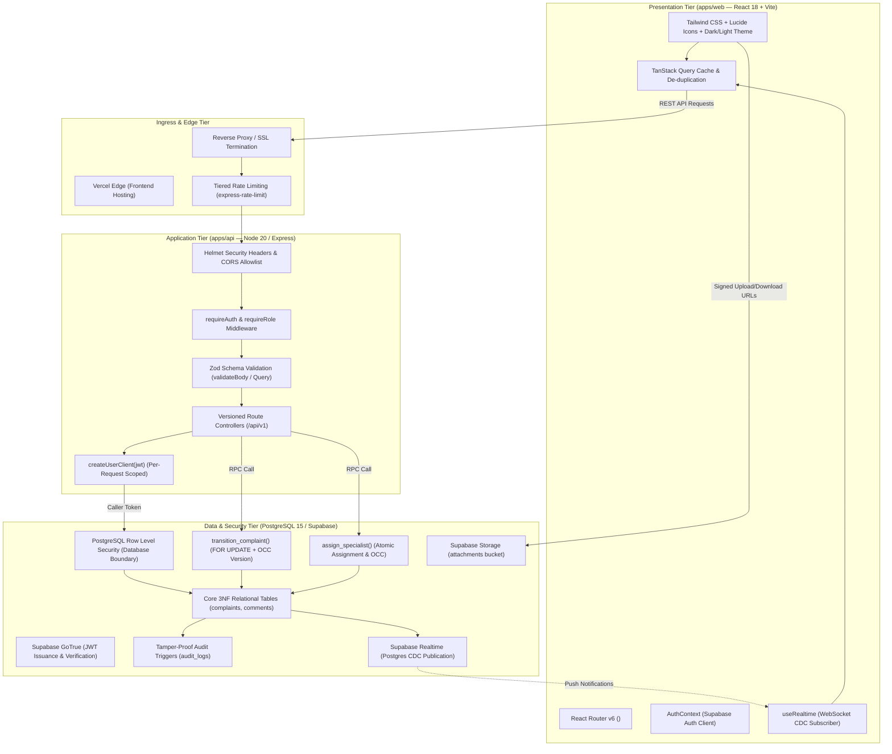
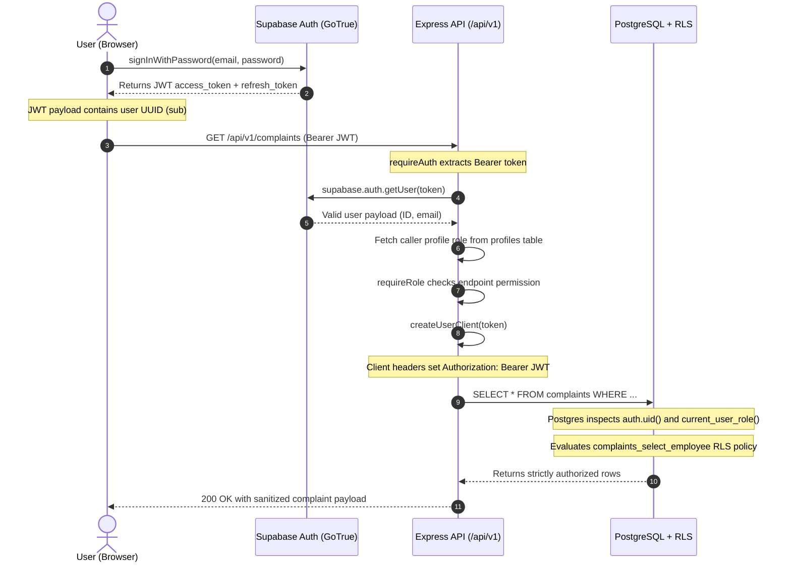
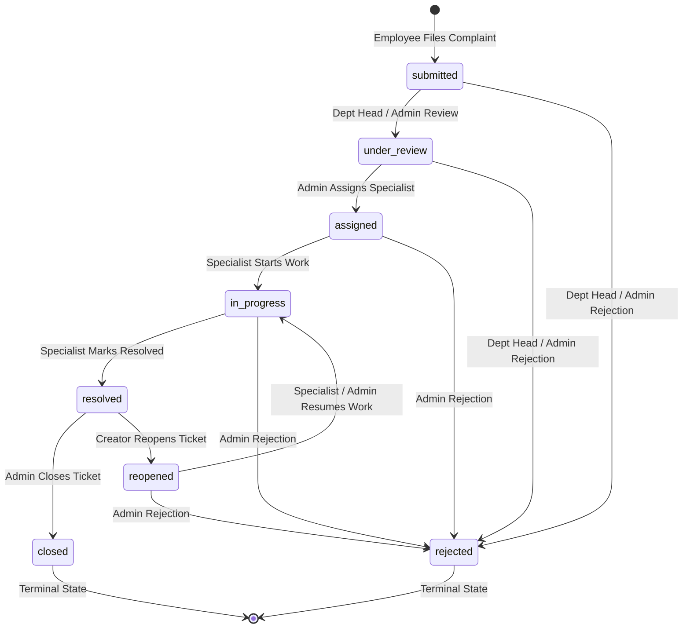
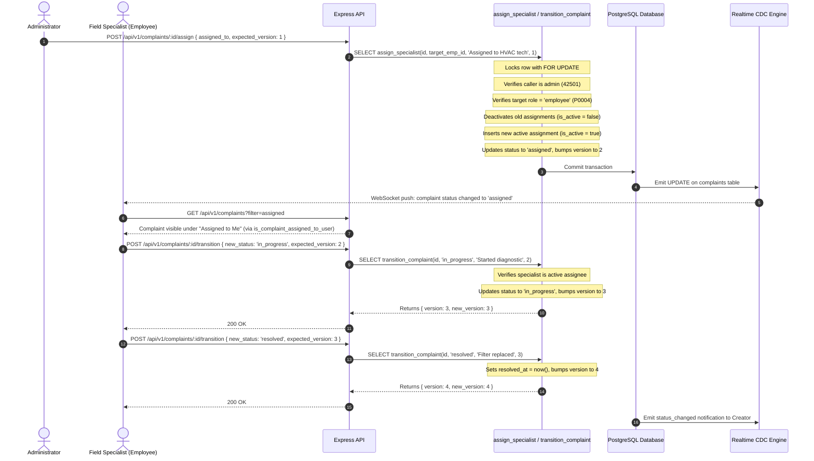
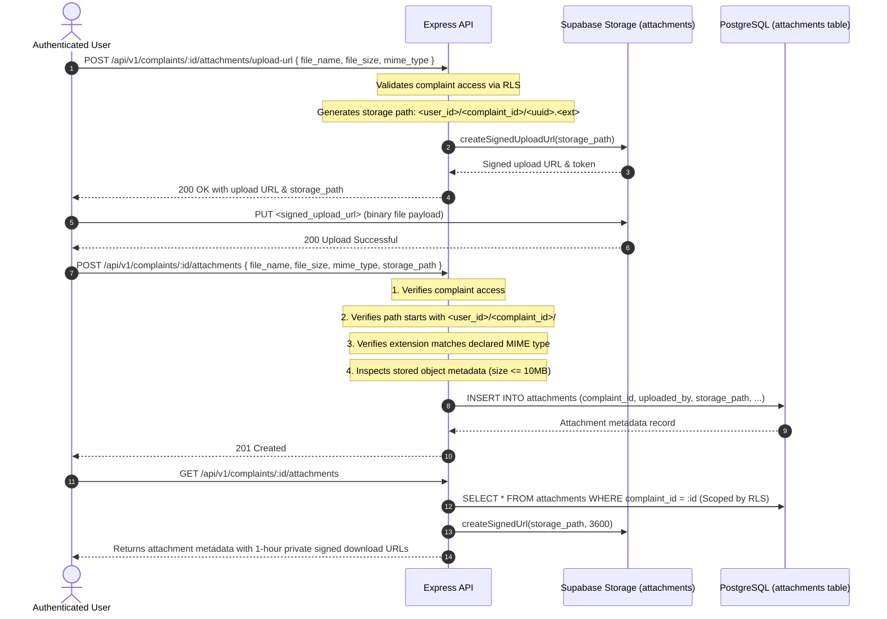
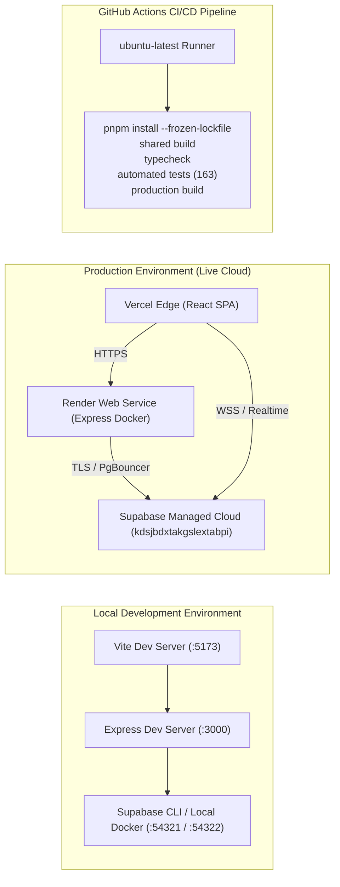

# ComplaintEase Enterprise — System Architecture

ComplaintEase is an enterprise incident management and complaint tracking platform designed around **defense-in-depth security**, **hybrid concurrency locking (OCC + Row Locks)**, **database-enforced Row-Level Security (RLS)**, and **tamper-resistant audit logging**.

---

## 1. High-Level System Architecture

The application is structured into four primary tiers:
1. **Presentation Tier (`apps/web`):** React 18, Vite, TypeScript, Tailwind CSS, TanStack Query v5, React Hook Form, and Supabase Realtime client.
2. **Application Tier (`apps/api`):** Node.js 20, Express, TypeScript, Zod, Pino logging, Helmet security headers, and express-rate-limit.
3. **Shared Contract Tier (`packages/shared`):** Canonical TypeScript enums, interfaces, and Zod validation schemas shared across web and API.
4. **Data & Storage Tier (`supabase/migrations`):** PostgreSQL 15, GoTrue Auth, Row-Level Security (RLS) policies, stored procedures (`transition_complaint`, `assign_specialist`), append-only audit triggers, and private storage buckets.

---

## 2. Authentication & Authorization Flow

Authentication and token verification follow a zero-trust model:
1. User logs in directly against Supabase GoTrue Auth.
2. Web client stores access and refresh tokens in memory/local storage and transmits the JWT via `Authorization: Bearer <token>`.
3. Express `requireAuth` verifies the token with Supabase and extracts the user profile.
4. Express `requireRole` checks the user role at the perimeter for fast rejection (403).
5. All database operations execute through a user-scoped Supabase client (`createUserClient(token)`), activating PostgreSQL `auth.uid()` and RLS policies.

---

## 3. Canonical Complaint Lifecycle (State Machine)

The complaint state machine is strictly defined in `@complaintease/shared` (`ALLOWED_TRANSITIONS`) and enforced in PostgreSQL (`allowed_transitions` table and `transition_complaint` RPC).
- Contains exactly **23 valid status transitions**.
- `closed` and `rejected` are **strictly terminal** (0 outgoing transitions).
- Direct table updates (`UPDATE complaints SET status = ...`) are rejected by trigger `trg_block_direct_status_update`.

---

## 4. Admin Assignment & Specialist Incident Resolution Sequence

This flow illustrates the end-to-end operational collaboration between an administrator, an assigned specialist, and the complaint creator:

---

## 5. Attachment Upload & Storage Access-Control Flow

Attachments follow a two-phase signed storage architecture to prevent storing binary data in the relational database while strictly checking ownership and file integrity:

---

## 6. Deployment Topology & Environments

ComplaintEase defines clear boundaries across development, staging, and production:

---

## 7. Key Architecture Invariants

1. **Database as the Absolute Security Boundary:** The API layer provides fast parameter validation and RBAC guards, but PostgreSQL Row Level Security (RLS) is the non-bypassable barrier. Non-admin users cannot access unassigned or third-party complaints, even if API code is modified.
2. **Deterministic State Progression:** No application role can transition tickets out of order, jump from closed/rejected, or execute raw status updates.
3. **Optimistic Concurrency Control (OCC):** Every mutating operation on complaints requires `expected_version`. Stale concurrent requests fail fast with HTTP 409 Conflict without causing database state corruption.
4. **Immutable Audit Trail:** Audited events are captured in `audit_logs` by database triggers and cannot be updated or deleted even by database administrators.
