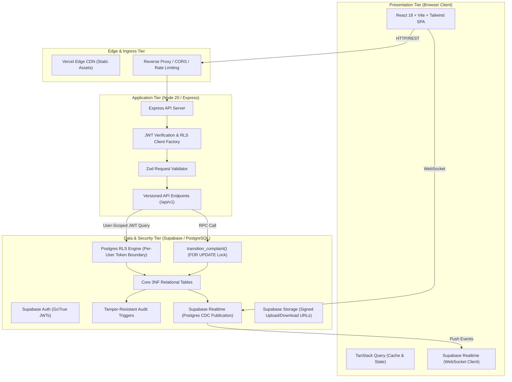
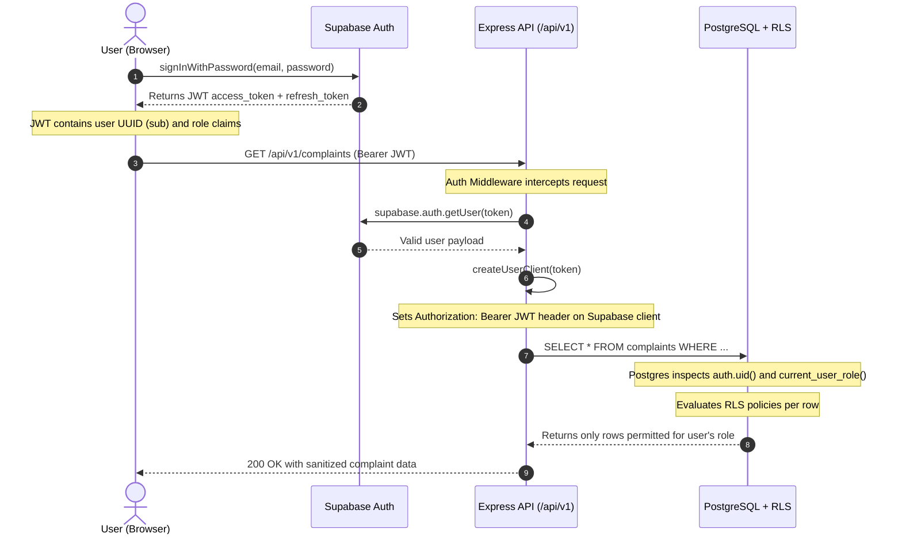

# ComplaintEase System Architecture

ComplaintEase is an enterprise-grade complaint and incident tracking system designed with **defense-in-depth security**, **high concurrency isolation**, and **sub-millisecond indexed data retrieval**.

---

## 1. High-Level Architecture Diagram

---

## 2. Authentication & Authorization Flow

---

## 3. Defense-in-Depth Security Strategy

ComplaintEase implements a multi-layer security perimeter:

1. **Network & Ingress Defense:**
   - **Helmet:** Adds secure HTTP headers (`Strict-Transport-Security`, `X-Content-Type-Options`, `Content-Security-Policy`).
   - **CORS Allowlist:** Strictly checks incoming `Origin` against production domain allowlists.
   - **Reverse Proxy Trust:** `app.set('trust proxy', 1)` enables accurate IP evaluation behind production ingress load balancers (Render, Kubernetes, Cloudflare).
   - **Tiered Rate Limiting:** Enforces `authMutationLimiter` (50 requests/15m) for sensitive authentication paths and `generalReadLimiter` (300 requests/15m) for operational endpoints.

2. **Application Boundary Defense:**
   - **Zod Validation:** Enforces strict structural schema constraints before business logic runs.
   - **Per-Request User Client:** The API strictly executes user queries through `createUserClient(token)` with the caller's JWT. `getAdminClient()` is forbidden from user request paths.
   - **Centralized Error Mapping:** Translates PostgreSQL/PostgREST error codes (`P0001` -> 400, `P0002`/`PGRST116` -> 404, `P0003` -> 409, `P0004`/`42501`/`P0005`/`P0006` -> 403) and sanitizes error payloads in production.
   - **Two-Stage Storage Pipeline:** Separates complaint creation from binary uploads, eliminating base64 string inlining in database records.

3. **Database Kernel Defense (RLS & Triggers):**
   - **Row Level Security:** Even if an API developer writes `SELECT * FROM complaints` with no WHERE clause, PostgreSQL evaluates RLS policies and hides rows outside the employee's ownership (admins see all complaints).
   - **Role Escalation Protection:** The trigger `trg_protect_profile_role` raises SQLSTATE `42501` on any non-admin attempt to modify the `role` column on `profiles`.
   - **Autonomous Initial History:** The trigger `trg_complaint_initial_history` writes the baseline `status_history` record atomically on insert without requiring service-role privileges.
   - **Tamper-Resistant Triggers:** Direct SQL `UPDATE complaints SET status = ...` is trapped and rejected by a `BEFORE UPDATE` trigger (`trg_block_direct_status_update`). All status transitions must invoke `transition_complaint()`. Audit log mutation is similarly blocked with `P0006`.
   - **Scoped Storage Policies:** RLS on `storage.objects` restricts read/write/delete access to bucket objects under `{complaint_id}/{filename}` to administrators and complaint authors.

---

## 4. Realtime Streaming Architecture

When a complaint status changes or an assignment is created:
1. `transition_complaint()` or `assign_specialist()` updates the `complaints` row, synchronizes assignments, and inserts a `status_history` record within an atomic ACID transaction.
2. The trigger `trg_notify_status_change` automatically inserts an in-app notification for the author.
3. PostgreSQL Logical Replication streams the CDC (Change Data Capture) event through the `supabase_realtime` publication.
4. The client's active WebSocket connection receives the broadcast and calls `queryClient.invalidateQueries()`, triggering immediate optimistic cache updates without full page refreshes and without polling loops.
