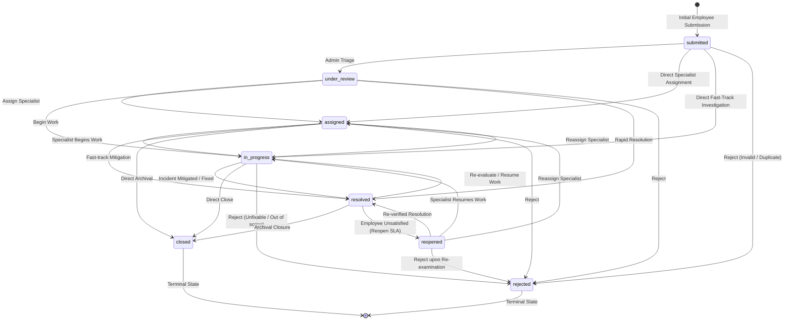

# Complaint Lifecycle State Machine

ComplaintEase models complaints as a deterministic **Finite State Machine (FSM)**.
Status cannot be updated directly through raw SQL `UPDATE` statements; it is strictly governed through the transactional database function `transition_complaint()`.

---

## 1. State Machine Diagram



---

## 2. Transition Rules Matrix (`ALLOWED_TRANSITIONS`)

The transitions configured in `packages/shared/src/types/enums.ts` and validated by the backend service are defined as follows:

| Current Status (`from_status`) | Allowed Target Statuses (`to_status`) | Permitted Roles | Operational Rationale |
|---|---|---|---|
| `submitted` | `under_review`, `assigned`, `in_progress`, `rejected` | `admin` | Triage, direct specialist assignment, or immediate rejection for spam/duplicate filings. |
| `under_review` | `assigned`, `in_progress`, `resolved`, `rejected` | `admin` | Routing to assigned worker, direct investigation, or rapid dismissal. |
| `assigned` | `in_progress`, `resolved`, `closed`, `rejected` | `admin` | Investigation commencement, immediate sign-off, or closure. |
| `in_progress` | `resolved`, `assigned`, `closed`, `rejected` | `admin` | Remediation completion (sets `resolved_at = now()`), worker reassignment, or rejection. |
| `resolved` | `closed`, `reopened`, `in_progress` | `admin`, **`employee`** (reopen only) | Creator empowerment to reopen if unsatisfied with the fix; admin closure or resume. |
| `reopened` | `in_progress`, `assigned`, `resolved`, `rejected` | `admin` | Secondary triage and re-assignment to active remediation. |
| `closed` | *(none)* | *(none)* | **Terminal State:** Read-only historical record; immutable. |
| `rejected` | *(none)* | *(none)* | **Terminal State:** Archival state for invalid or unserviceable complaints. |

---

## 3. Concurrency & Locking Mechanics

### Concurrency Challenges in Ticket Lifecycles
In high-throughput operational systems, multiple staff members or automated processes may attempt to act on the same incident ticket concurrently.
Without transactional locking and version verification, concurrent requests can lead to lost updates or illegal state transitions (e.g. attempting to resolve an already-closed or rejected incident).

### Hybrid Pessimistic / Optimistic Concurrency Control
ComplaintEase implements a hybrid concurrency control model at the PostgreSQL layer within `transition_complaint()`:

```sql
-- 1. Row-Level Exclusive Lock (Pessimistic)
SELECT * INTO v_complaint
FROM complaints
WHERE id = p_complaint_id
FOR UPDATE;

-- 2. Version Verification (Optimistic)
IF v_complaint.version != p_expected_version THEN
  RAISE EXCEPTION 'Conflict: expected version %, but current version is %',
    p_expected_version, v_complaint.version
    USING ERRCODE = 'P0003';
END IF;
```

### Architectural Guarantees & Flow:
1. **Pessimistic Row-Level Lock (`FOR UPDATE`):**
   - Serializes concurrent transactions targeting the same complaint row.
   - Prevents race conditions during state evaluation and history appending within PostgreSQL.
2. **Optimistic Version Check (`version = p_expected_version`):**
   - Confirms that the record has not mutated between read and commit phases.
   - If a conflict occurs, the database transaction aborts cleanly with SQLSTATE `P0003`, returning an HTTP `409 Conflict` error to the API client.
3. **Atomic State Mutation:**
   - On successful validation, `status` is updated, `version` is incremented (`version = version + 1`), and a corresponding entry is inserted into `status_history` in a single atomic transaction.
4. **Trigger-Guarded Immutability:**
   - The `trg_block_direct_status_update` trigger blocks standard SQL `UPDATE complaints SET status = ...` queries unless executed within the authorized transition context.

---

## 4. Atomic Specialist Assignment (`assign_specialist()`)

In addition to direct lifecycle transitions, assigning a specialist to an incident is encapsulated in the atomic PostgreSQL function `assign_specialist()`:

```sql
SELECT assign_specialist(
  p_complaint_id     => '...',
  p_assigned_to      => '...',
  p_note             => 'Assigned to HVAC Lead',
  p_expected_version => 2
);
```

### Guarantees:
1. **Administrative Caller & Target Role Authorization:** Validates `current_user_role() = 'admin'`, raising `42501` (403) for non-administrators, verifies the target specialist profile exists (`P0002` / 404 if missing), and enforces at the database boundary that `v_target_profile.role = 'employee'` (raising `P0001` / 400 if an administrator or unauthorized role is targeted).
2. **Pessimistic Row Lock & Mandatory Optimistic Versioning:** Acquires `SELECT ... FOR UPDATE` on the complaint and requires a non-null `p_expected_version >= 1` matching `complaint.version` (raising `P0003` / 409 on missing, `NULL`, or stale versions).
3. **Terminal State Guard:** Blocks assignment on terminal complaints (`closed` or `rejected`), raising SQLSTATE `P0001` (HTTP 400 `INVALID_TRANSITION`) to prevent assigning specialists to finalized tickets.
4. **Atomic State Synchronization:** If the complaint is currently in `submitted` or `under_review`, its status is automatically advanced to `assigned`, inserting a `status_history` record and incrementing `version` (while preserving current status when reassigning a specialist on a ticket already in `assigned`, `in_progress`, `reopened`, or `resolved`).
5. **Single Active Specialist Constraint:** Deactivates any prior active assignments for this complaint (`UPDATE assignments SET is_active = false`) and creates the new active assignment row in a single atomic transaction.

---

## 5. Terminal State Invariants

The states `closed` and `rejected` are strictly **terminal**:
- `ALLOWED_TRANSITIONS['closed'] = []`
- `ALLOWED_TRANSITIONS['rejected'] = []`

Once a complaint transitions to either state:
- Neither employees nor administrators can transition the ticket to any other status.
- `assign_specialist()` strictly blocks any attempt to assign specialists to `closed` or `rejected` complaints, raising SQLSTATE `P0001`.
- User interface action buttons are hidden, and a persistent terminal badge is rendered.
- All historical comments, assignments, attachments, and status history entries remain preserved for forensic audit compliance.
